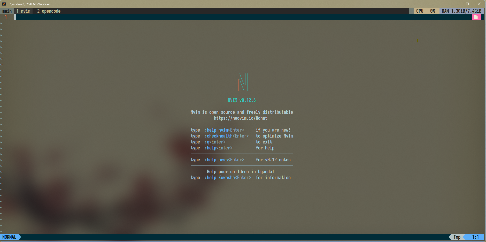
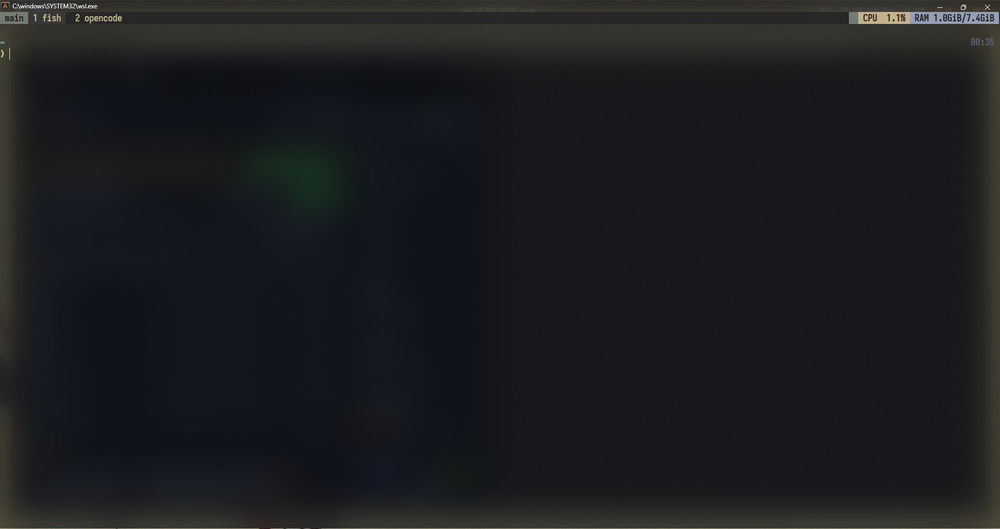
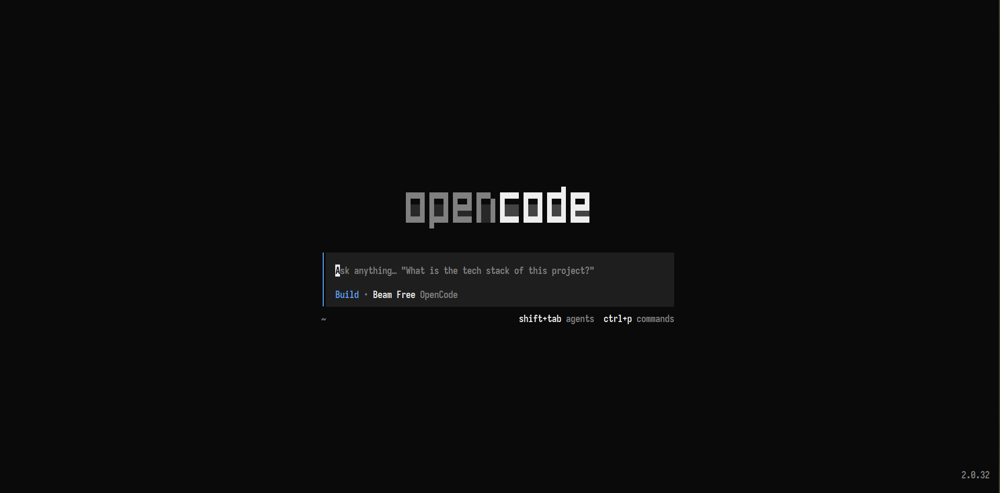
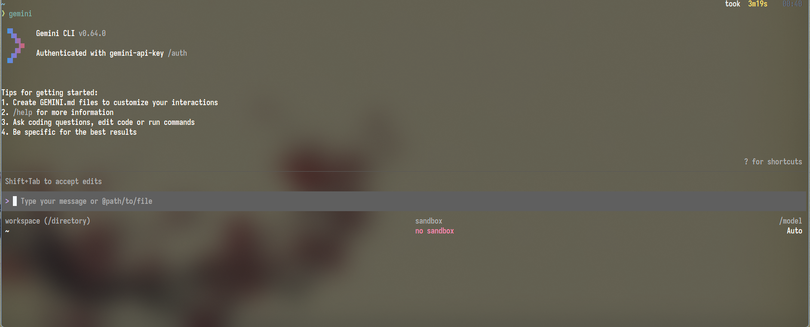
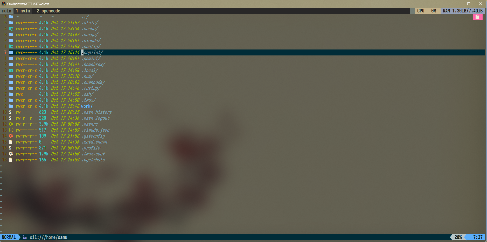
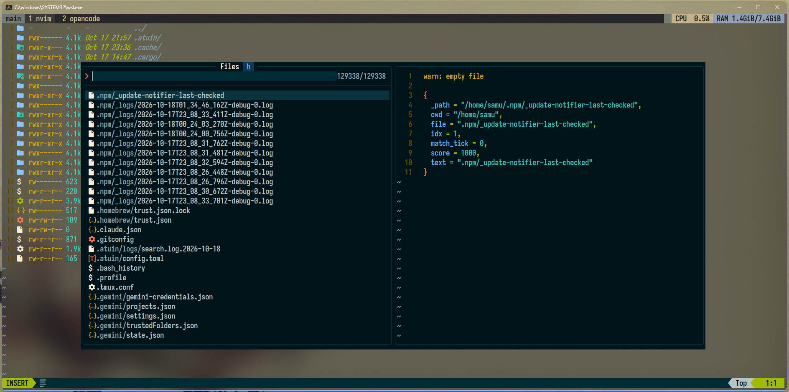
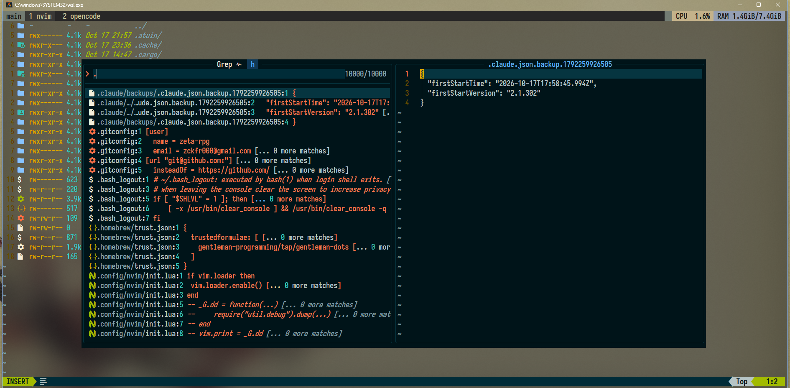

# Samu Dots — Minimalist 2026 ✨

Configuración **minimalista** de dotfiles para un entorno de desarrollo moderno en WSL/Linux, centrada en Neovim, la terminal y la integración con IA.

> Rama: `dots-minimalist-2026` — versión reducida y actualizada de [samu-dots](https://github.com/zeta-rpg/samu-dots).

---

## 🧩 En qué consisten estos dots

Este repositorio contiene únicamente las configuraciones esenciales que uso día a día, organizadas para instalarse con **GNU Stow** (cada carpeta es un "paquete" que se enlaza a `~/.config/`):

| Paquete | Descripción |
|---------|-------------|
| `nvim/` | Neovim con Lazy.nvim, plugins (LSP, Treesitter, Telescope/FZF, UI Kanagawa, Obsidian, etc.) y keymaps estilo Gentleman Programming / craftzdog. |
| `fish/` | Fish shell con temas (Kanagawa, Everforest), funciones útiles (`tmux`, `pj`, `nvm`), `fisher` y prompt con Starship. |
| `tmux/` | Tmux con tema Kanagawa (dragon), TPM, resurrect, which-key, navegación vim y ventana flotante. |
| `alacritty/` | Alacritty con fuente IosevkaTerm Nerd Font y tema Kanagawa. |
| `opencode/` | Configuración de OpenCode (IA en la terminal). |
| `gemini/` | Configuración de Gemini CLI. |

Cada carpeta está pensada para ser "stoweada" de forma independiente, así puedes instalar solo lo que necesites.

---

## 🔄 Cambios respecto a la rama `main`

La rama `main` contenía una configuración más amplia (inspirada en Gentleman Programming dots). Esta rama **minimalista** se deshace de lo que no uso:

**Eliminado:**
- `wezterm/`, `zellij/`, `nushell/` (terminales/shells que ya no uso).
- `screenshots/` y recursos gráficos pesados.
- Configuraciones de dashboard basadas en DevasLife.
- Archivos de respaldo (`nvim.bak.*`, `*.bak`).
- Completions auto-generadas de Fish (se regeneran solas).

**Agregado / actualizado:**
- `opencode/` y `gemini/` — integración con IA.
- Configuración actualizada de Neovim (estilo craftzdog: `lua/craftzdog/`, `after/lsp/`).
- `tmux/.tmux.conf` actualizado (tema Kanagawa dragon, floating window).
- `fish/` sincronizado con la configuración actual (temas, funciones, starship).
- `alacritty/` con la config vigente.

**Filosofía:** menos paquetes, menos ruido, solo lo que uso cada día.

> 🎨 Variante **Solarized Dark**: rama `dots-minimalist-2026-solarized` (alacritty + tmux + nvim con Solarized).

---

## 🤖 Relacionamiento con IA

Estos dots integran herramientas de IA directamente en el flujo de trabajo:

- **OpenCode** (`opencode/`): asistente de IA en la terminal. Configuración en `opencode/opencode.jsonc`. Se usa desde Neovim mediante el plugin `opencode.nvim` y desde la CLI.
- **Gemini CLI** (`gemini/`): configuración de la CLI de Gemini (settings, trusted folders, projects). Excluye credenciales por seguridad.
- **Neovim + IA:** plugins como `avante`, `codecompanion`, `copilot` y `gemini` están disponibles en la config de nvim para asistencia inline.

> Las credenciales (tokens, `gemini-credentials.json`, `google_accounts.json`, `opencode/service.json`) **no se versionan** por seguridad.

---

## ⚡ Instalación

### Requisitos

- Linux / WSL
- Neovim, Fish, Tmux, Alacritty
- GNU Stow (recomendado)
- OpenCode CLI y Gemini CLI (opcional, para IA)

### Pasos

1. Clonar el repositorio:
   ```bash
   git clone https://github.com/zeta-rpg/samu-dots.git ~/.samu-dots
   cd ~/.samu-dots
   git checkout dots-minimalist-2026
   ```

2. Aplicar con GNU Stow (solo lo que necesites):
   ```bash
   stow nvim fish tmux alacritty
   # Opcional:
   stow opencode gemini
   ```

   > Esto crea los symlinks automáticamente en `~/.config/` y `~/`.

3. Instalar plugins de Tmux (TPM):
   ```bash
   git clone https://github.com/tmux-plugins/tpm ~/.tmux/plugins/tpm
   # Luego dentro de tmux: prefix + I
   ```

4. Instalar plugins de Neovim: se instalan automáticamente al abrir nvim (Lazy.nvim).

### Sin Stow (manual)

Copia/symlinkea cada carpeta a `~/.config/<nombre>` (y `~/.tmux*` para tmux).

---

## 📸 Screenshots









---

## 🙏 Créditos", "oldString">
## 🙏 Créditos

- **DevasLife** — inspiración del dashboard y estructura de nvim ([DevasLife/dots](https://github.com/DevasLife/dots)).
- **OpenCode** — integración de IA en el flujo de desarrollo ([opencode.ai](https://opencode.ai)).
- **Gentleman Programming** — base original de la configuración ([GentlemanProgramming/dots](https://github.com/GentlemanProgramming/dots)).
- **craftzdog** — estilo de configuración de Neovim.

---

## 📝 Licencia

MIT © zeta-rpg
